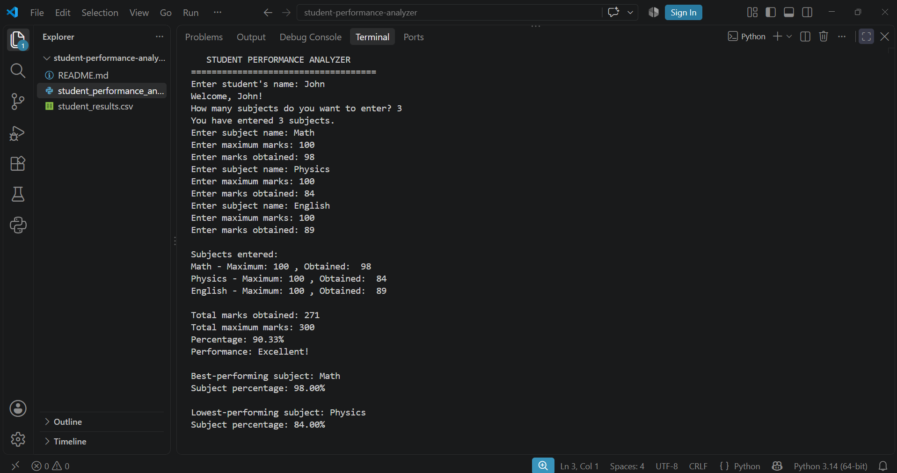

# Student Performance Analyzer

A Python-based command-line application that calculates student academic performance, analyzes subject-wise results, and saves the results in a CSV file.

## About the Project

The **Student Performance Analyzer** is a Python project developed to calculate and analyze students' academic performance based on the marks entered for each subject.

The program allows users to enter a student's name, add multiple subjects, and provide maximum and obtained marks. It then calculates the total marks, overall percentage, and performance category. It also identifies the best-performing and lowest-performing subjects and saves the subject-wise results in a CSV file.

I created this project to strengthen my understanding of Python programming, input validation, logical problem-solving, calculations, and CSV file handling.

## Program Output



## Features

- **Student Information:** Enter a student's name.
- **Multiple Subjects:** Add multiple subjects for analysis.
- **Marks Entry:** Enter maximum marks and marks obtained for each subject.
- **Input Validation:** Prevent empty subject names and invalid numerical entries.
- **Marks Validation:** Ensure maximum marks are positive and obtained marks are within the valid range.
- **Total Marks Calculation:** Calculate total obtained marks and maximum marks.
- **Percentage Calculation:** Calculate the overall academic percentage.
- **Performance Classification:** Display a performance category based on the overall percentage.
- **Subject Analysis:** Identify the best-performing and lowest-performing subjects based on their percentages.
- **CSV File Storage:** Save subject-wise marks and percentages in a CSV file.

## Technologies Used

- **Python 3**
- **CSV Module:** For storing subject-wise results.
- **OS Module:** For managing file paths.

## Project Structure

```text
student-performance-analyzer/
│
├── student_performance_analyzer.py
├── student_results.csv
├── Student-Performance-Output.png
└── README.md
```

## How to Run

### Prerequisites

- Python 3 installed on your computer.
- A code editor such as Visual Studio Code (recommended).

### Installation and Execution

1. Clone this repository:

   ```bash
   git clone https://github.com/aabisraza/student-performance-analyzer.git
   ```

2. Navigate to the project directory:

   ```bash
   cd student-performance-analyzer
   ```

3. Run the Python program:

   ```bash
   python student_performance_analyzer.py
   ```

No additional Python packages are required because the project uses Python's built-in modules.

## Expected Results

After execution, the program displays:

- Student name and entered subjects.
- Maximum marks and marks obtained for each subject.
- Total marks obtained and total maximum marks.
- Overall percentage.
- Performance classification.
- Best-performing subject and its percentage.
- Lowest-performing subject and its percentage.

The program also generates a `student_results.csv` file containing the subject-wise results.

## CSV Data Storage

The program saves the following information in `student_results.csv`:

| Column | Description |
|---|---|
| Student Name | Name of the student |
| Subject | Subject name |
| Maximum Marks | Maximum possible marks |
| Marks Obtained | Marks achieved |
| Percentage | Subject-wise percentage |

**Note:** Each execution replaces the previous contents of the CSV file with the latest results.

## What I Learned

Through developing this project, I practiced:

- Taking and processing user input.
- Using `for` and `while` loops.
- Applying conditional statements.
- Handling invalid input using `try` and `except`.
- Working with lists and dictionaries.
- Performing calculations using Python.
- Using built-in functions such as `max()` and `min()`.
- Applying lambda expressions for subject analysis.
- Writing data to CSV files.
- Managing file paths using the `os` module.

## Future Improvements

Some features I would like to explore in future versions include:

- Supporting multiple students in a single execution.
- Preserving previous student records in the CSV file.
- Generating more detailed academic performance reports.
- Improving the presentation of results.

## Author

**Aabis Ali Raza**

GitHub: [@aabisraza](https://github.com/aabisraza)

---

*This project is part of my journey in learning Python programming and developing practical problem-solving skills.*